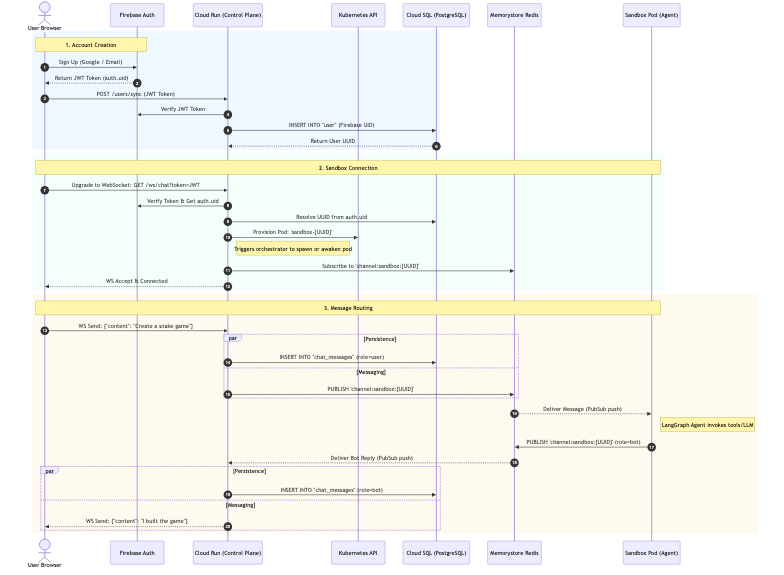

# User Data Flow: From Creation to Message Exchange

This document maps the journey of a user from account creation to real-time interaction with the AI Sandbox agent.

## User Lifecycle Flow

## Flow Mechanics

### 1. Account Creation & Synchronization
Firebase Auth manages the actual credentials and OAuth handshakes. However, because our relational logic lives in PostgreSQL, we perform a "sync" step. When a user logs in for the first time, the frontend passes the Firebase Identity JWT to the Control Plane. The Control Plane verifies the JWT using the Firebase Admin SDK and inserts a mirrored record into PostgreSQL, returning an internal `UUID`. All subsequent database associations (Sandboxes, Activity, Assets) are bound to this internal PostgreSQL UUID, not the string-based Firebase UID.

### 2. Connection Upgrade (This is very buggy. Make improvement here.)
The architecture strictly avoids putting heavy LLM execution logic into the API server. When a user requests a WebSocket connection (`/ws/chat`), the Control Plane authenticates the token and accepts the upgrade. Immediately after, it makes an async call to the Kubernetes API to verify if the user's dedicated Sandbox Pod is running. If the user was offline and their pod was garbage collected, the Control Plane instructs K8s to spin up a new instance. 

### 3. Durable Message Exchange
The Control Plane acts as a router and never runs the agent.
When the user sends a message, the Control Plane saves it to PostgreSQL and publishes it to the Cloud Pub/Sub topic `user-messages` with the sandbox name as the ordering key.
A separate Dispatcher validates that the user has an active session on that sandbox and POSTs the message to the pod's intake endpoint.
It acks the Pub/Sub message only when the sandbox answers 202, so undelivered messages are retried and eventually dead-lettered.

The Sandbox Pod queues the message, runs the LangGraph turn, and streams `token` and `tool_call` frames to the Redis channel `channel:sandbox:{sandbox_name}`.
The Control Plane relays those frames to the browser's WebSocket.
When the turn finishes, the Sandbox POSTs the final reply to the Control Plane's `/internal/sandbox/reply` callback using a short-lived token.
The Control Plane writes it to PostgreSQL first, then pushes it to the WebSocket.
Cancel bypasses the queue and is published directly to the Redis channel.

See `12_durable_delivery.md` for guarantees, security and failure behaviour.
